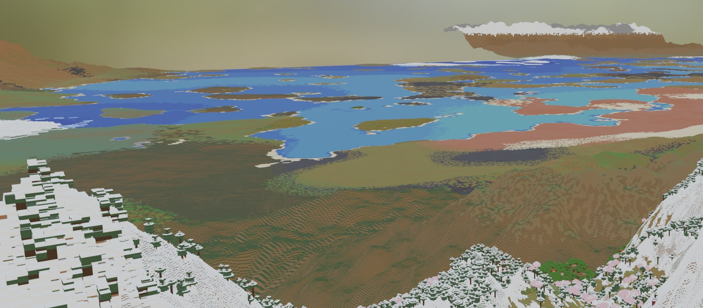

# Distant Horizons Importer for Blender

Import the terrain that the [Distant Horizons](https://modrinth.com/mod/distanthorizons) (DH) Minecraft mod has
already generated (thousands of chunks of level-of-detail data) straight into Blender as lightweight,
vertex-coloured block meshes. It's built for renders and cinematics that need a huge background.



Tools such as Mineways or replay exporters give you full-detail blocks for a few chunks. DH has already
stored the rest of the world, out to tens of kilometres, at decreasing detail. This add-on reads that data
directly from `DistantHorizons.sqlite` and builds:

- **Distance rings:** full 1-block detail near your subject, and coarser detail further out (2, 4, … 128
  blocks per column). Rings meet with no gaps or overlaps, and short "skirts" hide cracks where the detail
  level changes.
- **Colours like DH's:** each block's real textures from your Minecraft jar (and any resource packs) are
  averaged per face (top, side and bottom), and biome tint is applied to grass, leaves and water.
- **Light meshes:** hidden faces and sealed caves are removed, and neighbouring faces of the same block are
  merged (greedy meshing).
- **A hole for a detailed export:** a rectangular hole can be left where your Mineways or other full-detail
  export sits. **Align to selected Mineways** finds that placement automatically by matching terrain heights.
- **Imports without freezing Blender:** tiles are built a few at a time, with a progress bar. Esc cancels
  and keeps what has been built. One object per tile, one collection per ring, and a face cap with a live
  estimate.

The database is opened **read-only**, and the add-on never modifies your world.

---

## Requirements

| | |
|---|---|
| Blender | 4.2 or newer (developed on 5.2 LTS) |
| Distant Horizons | 2.x data stored as `DataFormatVersion 2` (checked with DH 2.3.3) |
| Minecraft | any Java edition, with the jar of the version the world was played in for colours |
| Mod loader | doesn't matter (Fabric, Forge and NeoForge store the same format) |
| Python packages | `zstandard`, installed from the add-on preferences with one click |

## Install

1. Download `dh_import.py`.
2. In Blender, go to **Edit → Preferences → Add-ons → ⌄ (top right) → Install from Disk…** and pick `dh_import.py`.
3. Expand the add-on and press **Install zstandard**, then restart Blender.
   DH compresses its data with Zstandard, which Blender's Python doesn't include. The button pip-installs it
   into your Blender user `scripts/modules` folder, so no admin rights are needed.
   *If you update Blender to a version with a newer Python, press the button again.*

The panel is in the **3D Viewport → N sidebar → DH Import** tab.

## Quick start

1. **Close Minecraft**, so DH isn't writing to the database.
2. **Database:** point it at the world's `DistantHorizons.sqlite`.
   - Singleplayer: `.minecraft/saves/<world>/data/DistantHorizons.sqlite`
   - Multiplayer and replays: `.minecraft/Distant_Horizons_server_data/<server>/<id>@<dimension>/DistantHorizons.sqlite`
3. **Center X / Center Z:** the Minecraft block that should land at Blender's origin, e.g. where your subject
   stands (from the F3 screen: the first and last numbers of `XYZ:`).
4. **Origin Y:** the Minecraft height that should be Blender Z = 0, usually the ground under your subject.
5. **Minecraft jar:** e.g. `.minecraft/versions/1.20.1/1.20.1.jar`, for texture colours.
6. Press **Import**.

Before a big import, enable only ring 1 for a first quick test.

## Using it with a Mineways (or other full-detail) export

1. Import your Mineways export into Blender as usual.
2. Select **only the Mineways terrain objects** and press **Align to selected Mineways**.
   It compares the heights of the Mineways mesh with DH's full-detail data and sets **Scale**,
   **Center X/Z**, **Origin Y** and the **hole** so that DH lines up block-for-block around it. The message
   shows the match score, e.g. `match 94% (next best 28%)`. If the result isn't clear-cut, nothing is changed.
3. Press **Import**. DH terrain fills everything around the Mineways area, with no overlap.

Alignment needs DH full-detail (level 0) data under the selection, a Z-up mesh that isn't rotated or
mirrored, and single-block faces (don't use Mineways' face merging for this). Increase **Search** if the
Mineways mesh is more than 32 blocks off.

You can also set the hole by hand: tick **Leave hole** and enter the selection corners from Mineways' export
dialog as **Min/Max X/Z** (inclusive block coordinates).

## Settings

| Setting | What it does |
|---|---|
| Center X / Z, Origin Y | The Minecraft position mapped to Blender (0, 0, 0). Everything is imported near the origin, which avoids floating-point jitter at large coordinates. |
| World bottom Y | The world's minimum Y: −64 for vanilla 1.18+, and different for some datapacks. |
| Scale | Metres per block. Mineways usually exports 1 block = 1 m. *Align to selected Mineways* measures and sets this for you. |
| Rings | Up to five rings: *Out to* is the outer edge in blocks from the center, *Level* is the DH detail level (0 = 1 block per column, 1 = 2, 2 = 4 … 7 = 128). Defaults: 400/L0, 2,000/L2, 8,000/L4, 32,000/L6, 64,000/L7. Each ring costs roughly the same number of faces. |
| Face cap | Stops the import at this many faces. Rings are built from the center outward, so the cap drops far tiles first. The panel shows a live estimate. |
| Skip sealed caves | Builds only faces that touch sky-lit air (removes about 80% of the faces in typical terrain). |
| Merge faces | Greedy merging of neighbouring faces with the same block (about 30% fewer faces on real terrain). |
| Ring seam skirts | Short walls along ring borders that hide cracks between detail levels (about 1% more faces). |
| Tiles per update | Higher is faster, but the UI is less responsive during the import. |
| Texture colors | Average block colours from the jar and resource packs. Off uses a small built-in palette. |
| Resource packs | Optional `.zip` files or folders separated by `;`, where the first one wins. Mod `.jar` files work too, which gives modded blocks real colours. |

### Memory guide

Roughly **0.3 GB of RAM per million faces** in Blender (more right after an import, because of undo) and
**0.2–0.3 GB of VRAM per million faces** for Cycles. Save before big imports and consider lowering
*Preferences → System → Undo Steps*.

## Rendering tips

Distant DH terrain can look like a flat painted floor. The geometry is fine; the depth cues are missing:

- **Aerial perspective:** enable the Mist pass and blend toward a hazy sky colour in the compositor.
- **A low sun (10–25°) with shadows,** so gentle hills show their shape.
- **Per-block colour variation:** snap world position to the block grid, feed it to White Noise, and
  multiply the vertex colour by about 0.9–1.1. Add Ambient Occlusion for Cycles.

The material is `DH_VertexColor` (a *Color Attribute* node named `Col` into Principled BSDF).

## Command-line tools (no Blender)

The `tools/` folder has standalone scripts. They need `pip install numpy zstandard`.

| Script | Use |
|---|---|
| `tools/dh_inspect.py DB` | Schema, row counts, detail levels, and hex dumps and decompression probes of sample blobs. Run this first if a DH update ever changes the format. |
| `tools/dh_decode.py DB survey` | Per detail level: section counts, real vs down-sampled columns, and the area covered by real data. |
| `tools/dh_decode.py DB coverage --mark X Z` | A PNG map coloured by the finest real detail level, so you can see where full-detail data exists. |
| `tools/dh_decode.py DB probe --block X Z` | What every detail level holds at one spot. |
| `tools/dh_decode.py DB section --level 0 --block X Z` | Decode one section: stats, height and block previews, and an `.npz` dump. |
| `tools/dh_decode.py DB nearby --block X Z` | A text map of real, down-sampled and missing sections around a spot. |

**Down-sampled** columns are filler that DH copies down from coarser levels where it never had real chunks.
Full 1-block detail only exists where chunks were actually loaded or generated at full detail. Check
`coverage` before choosing your camera spot.

## How it works

1. **Streaming reads.** Sections are fetched one at a time with indexed SQLite queries (`DetailLevel, PosX,
   PosZ`) and kept in a small LRU cache. The whole database is never loaded.
2. **Decoding.** Each section is 64 × 64 columns, and each column is a list of vertical runs of one block
   state. See [docs/FORMAT.md](docs/FORMAT.md) for the byte layout. Decoding is vectorised with numpy.
3. **Culling.** A face is emitted where a solid run touches open space: air or plants, and with *Skip sealed
   caves* only open space with sky light. Thin blocks (snow layers, carpets) only hide what they actually
   cover. Grass, podzol and mycelium use their snowy colours when snow sits on them, following Minecraft's
   own rule.
4. **Rings and tiles.** Ring borders snap to the next ring's column grid, so the rings tile exactly. Each
   ring is cut into tiles of 256 × 256 columns, and each tile is meshed with a one-column margin so its
   edges cull correctly.
5. **Greedy merging, then Blender.** Top and bottom faces merge into rectangles, and walls merge into strips.
   Meshes are created with `foreach_set`, with corner vertex colours and one shared material.

## Limitations

- **Every block is a cube** (or a thin slab for snow and carpets). Plants are skipped, and stairs, fences and
  other shapes appear as cubes. DH stores block states, so real block models are a possible future feature.
- **No textures, only colours** (DH-style averages), so tools like MCprep's *Prep Materials* don't apply
  to the DH meshes.
- **Formats:** only DH `DataFormatVersion 2` with uncompressed, Zstandard or LZMA blobs. LZ4-compressed
  databases aren't supported yet. Sections the add-on can't read are counted and reported after the import.

## Tests

```
pip install numpy pytest
python -m pytest tests
```

The tests build small databases with a Python port of DH's own writer. They check exact decoding, that the
rings tile with no gaps or overlaps, that greedy merging keeps the surface area, the hole, snow-step walls,
and Mineways alignment. No Blender or Minecraft files are needed.

## Credits & license

- The data format was reimplemented from the open-source
  [Distant Horizons core](https://gitlab.com/distant-horizons-team/distant-horizons-core) (LGPL-3.0).
  **This project is not affiliated with or endorsed by the Distant Horizons team.**
- Minecraft is a trademark of Mojang/Microsoft. This repository contains **no Minecraft assets**: colours are
  computed at import time from the jar on your own computer.
- Licensed under the **GNU GPL v3.0 or later**, like Blender add-ons in general. See [LICENSE](LICENSE).
